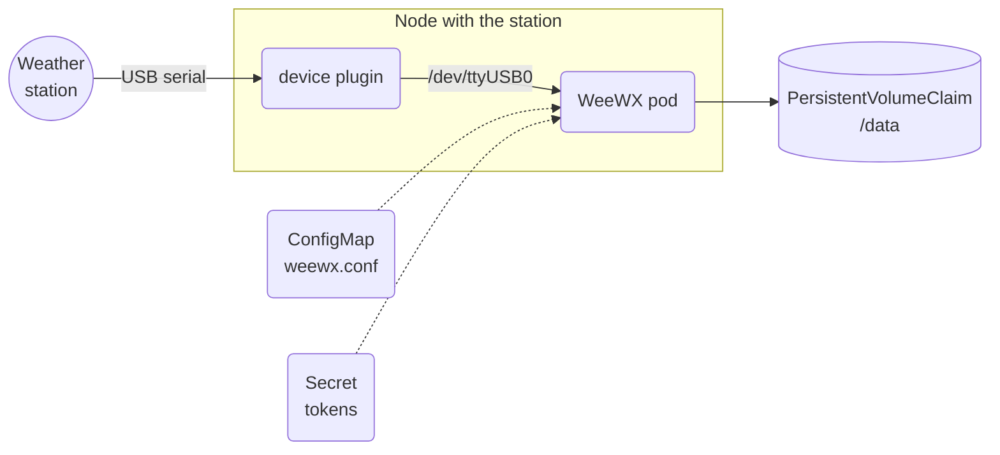

# Deploying on Kubernetes #

This guide runs WeeWX on a Kubernetes cluster, reading a weather station
attached to a node's USB port.  The manifests are intentionally generic —
no specific storage provider or secrets tooling is assumed — so you can
adapt them to your environment.

Three problems make this deployment different from a typical web app, and
the design here solves each without a privileged container:

- **Device access** — the pod needs the station's serial port, which
  containers cannot normally touch.
- **Scheduling** — the pod must run on whichever node the station is
  physically plugged into, and follow it if the cable moves.
- **Time** — WeeWX syncs the station console's clock from container time,
  so a wrong container timezone silently rewrites the station clock.

The guide builds up in stages.  Each stage is a complete, working system —
stop whenever you have what you need:

1. [Advertise the station](#advertise-the-station) — the
   [`device-plugin/`](device-plugin) DaemonSet.
1. [Deploy WeeWX](#deploy-weewx) — the [`manifests/`](manifests) base.
1. [Install extensions](#install-extensions) — pinned packages, rebuilt on
   every pod start.
1. [Keep secrets out of the config](#keep-secrets-out-of-the-config) —
   tokens rendered from a `Secret`.
1. [Migrate an existing station](#migrate-an-existing-station) — move your
   database into the cluster without losing a record.

> [!NOTE]
> Every example pins the image to the major version tag `:5`, matching the
> recommendation in the [Image tags](../../../README.md#image-tags) section
> of the README.

## Prerequisites ##

- A Kubernetes cluster and `kubectl` configured to reach it.
- A default `StorageClass` (or edit [`pvc.yaml`](manifests/pvc.yaml)).
- The weather station plugged into a node over USB, with a kernel driver
  that exposes it as a serial device.  Verify on that node before anything
  else: `dmesg` should show the adapter binding (for example
  `cp210x converter now attached to ttyUSB0`) and the device should exist
  as `/dev/ttyUSB0` or similar.
- A `weewx.conf` for your station (the
  [first-run steps](../../../README.md#running) in the README generate
  one).

## Advertise the station ##

Containers cannot open host devices: even with the device node mounted
into the pod, the kernel's device cgroup blocks access unless the
container is privileged.  A [device plugin] solves this properly — it
advertises the device to the kubelet as an *extended resource*, and any
pod that requests the resource receives the device in its cgroup
allowlist, no privilege required.

[`device-plugin/generic-device-plugin.yaml`](device-plugin/generic-device-plugin.yaml)
deploys [generic-device-plugin] as a DaemonSet that matches
`/dev/ttyUSB*` and advertises it as `example.com/weather-station`.  Only
a node where the device actually exists advertises non-zero capacity —
which is what makes scheduling automatic in the next stage.

1. Apply the DaemonSet:

    ```console
    kubectl apply -f device-plugin/generic-device-plugin.yaml
    ```

1. Confirm that exactly the node with the station advertises the resource:

    ```console
    kubectl get nodes \
      -o custom-columns='NODE:.metadata.name,STATION:.status.allocatable.example\.com/weather-station'
    ```

### Host permissions ###

The device plugin grants the pod *cgroup* access, but the device node's
file permissions still apply, and the container runs as the non-root
`weewx` user (uid 1000).

- On most distributions the tty is owned `root:dialout` with group
  read/write, and `dialout` is gid 20.  The deployment in the next stage
  already runs with `supplementalGroups: [20]`, which is all it takes.
  If your host uses a different gid, change the number to match
  (`ls -ln /dev/ttyUSB0` on the node shows it).
- On minimal or immutable node operating systems without a `dialout`
  group (for example Talos Linux), set the device mode with a udev rule
  on the host instead, keyed to your adapter's USB IDs:

    ```text
    SUBSYSTEM=="tty", ATTRS{idVendor}=="10c4", ATTRS{idProduct}=="ea60", MODE="0666"
    ```

  World-rw on the host is less alarming than it looks: the device cgroup
  remains the real gate, so only the pod the plugin allocates the device
  to can open it.  (Avoid `OWNER=` with a numeric uid — udev resolves it
  against `/etc/passwd` and ignores the rule when no entry exists.)

## Deploy WeeWX ##

One namespace holding one WeeWX instance: persistent data, your
`weewx.conf` delivered as a generated ConfigMap, and the station's serial
port injected by the device plugin.



### Files ###

Everything lives in [`manifests/`](manifests), a ready-to-use [Kustomize]
base:

| File | Resource | Purpose |
| ---- | -------- | ------- |
| [`namespace.yaml`](manifests/namespace.yaml) | `Namespace` | Isolates the instance. |
| [`pvc.yaml`](manifests/pvc.yaml) | `PersistentVolumeClaim` | Persistent `/data` storage for the database. |
| [`secret.yaml`](manifests/secret.yaml) | `Secret` | Values for `${WEEWX_*}` tokens in the config. |
| [`deployment.yaml`](manifests/deployment.yaml) | `Deployment` | The WeeWX pod. |
| [`kustomization.yaml`](manifests/kustomization.yaml) | — | Generates ConfigMaps from `weewx.conf` and `requirements.txt`. |

### Steps ###

1. Copy your `weewx.conf` into [`manifests/`](manifests) — the
   `configMapGenerator` expects it next to `kustomization.yaml`.  Make
   sure the station's `port` matches the device the plugin advertises
   (`/dev/ttyUSB0`).

1. Set `TZ` in [`deployment.yaml`](manifests/deployment.yaml) to the
   station's timezone.

    > [!WARNING]
    > This is not cosmetic.  WeeWX sets the station console's clock from
    > container time, and the console stamps archive records with it.  A
    > container left on UTC rewrites the console clock within seconds of
    > starting, and records written afterward carry wrong timestamps.

1. Apply the manifests:

    ```console
    kubectl apply -k manifests/
    ```

1. Watch the pod start on the node with the station, and check the log
   for a driver handshake and a small clock error:

    ```console
    kubectl -n weewx get pods -o wide
    kubectl -n weewx logs deploy/weewx --follow
    ```

   On first start WeeWX creates a fresh database and backfills whatever
   archive records the station's logger holds.

### Why it works this way ###

- **No `nodeSelector`.**  The `example.com/weather-station: 1` resource
  request is the scheduling constraint: only the node with the station
  has capacity.  Labels would say where the station *was*; the resource
  says where it *is*.
- **`strategy: Recreate`.**  The serial port and the `ReadWriteOnce`
  volume each allow only one consumer, so the old pod must exit before a
  replacement starts.
- **Generated ConfigMaps.**  The ConfigMap names carry a content hash, so
  editing `weewx.conf` or `requirements.txt` and re-applying rolls the
  pod automatically.  Editing the `Secret` does not — run
  `kubectl -n weewx rollout restart deploy/weewx` after a secret change.
- **Nothing runs as root.**  The pod runs as uid 1000 with all
  capabilities dropped and a read-only root filesystem; the device plugin
  needs root only for its socket in the kubelet's plugin directory.

### Moving the station to another node ###

Plug the station into any other node, then delete the running pod:

```console
kubectl -n weewx delete pod -l app=weewx
```

The old pod stays bound to its original node (Kubernetes never
reschedules a placed pod), so deleting it is what frees the replacement
to follow the resource — which moved with the cable.

## Install extensions ##

List extensions in [`requirements.txt`](manifests/requirements.txt), one
pinned requirement per line.  An initContainer pip-installs them on every
pod start into an `emptyDir` mounted at the image's `PIP_TARGET` /
`PYTHONPATH` (see
[Installing Python Packages](../../../README.md#installing-python-packages)),
so the pinned versions are the only copies that can ever be live and the
data volume stays free of package files.

Two line formats:

- PyPI-hosted: `some-weewx-extension==1.2.3`
- GitHub-only, as a tag tarball (the image has no `git` binary, so
  `git+https` URLs will not work):

    ```text
    weewx-home-assistant @ https://github.com/felddy/weewx-home-assistant/archive/refs/tags/v1.3.2.tar.gz
    ```

Wire the extension into `weewx.conf` as its documentation describes (for
example adding its service to `report_services`), then re-apply — the
ConfigMap hash change rolls the pod.

## Keep secrets out of the config ##

`weewx.conf` often carries upload passwords and API keys that do not
belong in a ConfigMap or in version control.  Replace each secret value
with a `${WEEWX_*}` token:

```ini
[[Wunderground]]
    station = KXXXXXXXX99
    password = ${WEEWX_WU_PASSWORD}
```

and add the real value under the same name in
[`secret.yaml`](manifests/secret.yaml).  The `render-config`
initContainer substitutes the tokens at pod start; everything else in the
file passes through byte-for-byte, and a config with no tokens works
unchanged.  Manage the `Secret` itself with whatever your cluster uses —
SOPS, Sealed Secrets, or an external secrets operator.

## Migrate an existing station ##

To keep the history from an existing WeeWX installation, copy its
`weewx.sdb` into the volume between pod generations:

1. Scale down and start a throwaway pod that mounts the volume:

    ```console
    kubectl -n weewx scale deploy/weewx --replicas=0
    kubectl apply -f - <<'EOF'
    apiVersion: v1
    kind: Pod
    metadata:
      name: data-helper
      namespace: weewx
    spec:
      restartPolicy: Never
      securityContext:
        runAsUser: 1000
        runAsGroup: 1000
        fsGroup: 1000
        runAsNonRoot: true
      containers:
        - name: helper
          image: ghcr.io/felddy/weewx:5
          command: ["sleep", "1800"]
          volumeMounts:
            - name: weewx-data
              mountPath: /data
      volumes:
        - name: weewx-data
          persistentVolumeClaim:
            claimName: weewx-data
    EOF
    ```

1. Copy the database in and restart:

    ```console
    kubectl -n weewx cp weewx.sdb data-helper:/data/weewx.sdb
    kubectl -n weewx delete pod data-helper
    kubectl -n weewx scale deploy/weewx --replicas=1
    ```

On start, WeeWX resumes from the last record in the copied database and
backfills the gap from the station logger's memory — stations with
on-board logging (such as the Davis Vantage series) typically buffer days
of records, so a careful migration loses nothing.

[device plugin]: https://kubernetes.io/docs/concepts/extend-kubernetes/compute-storage-net/device-plugins/
[generic-device-plugin]: https://github.com/squat/generic-device-plugin
[Kustomize]: https://kustomize.io/
